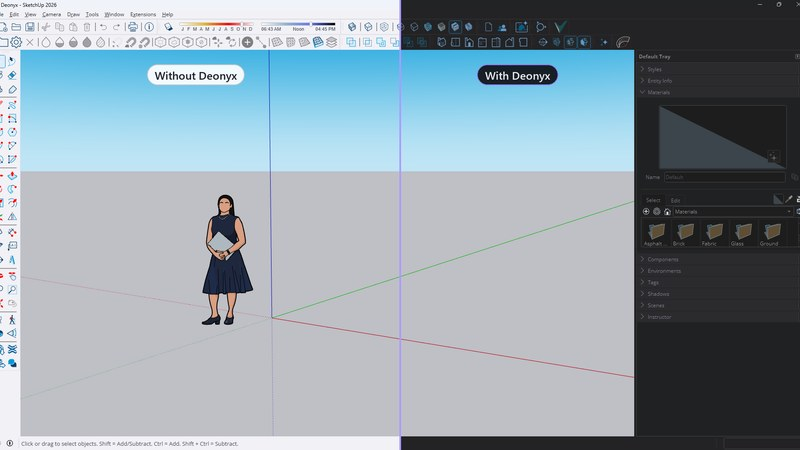
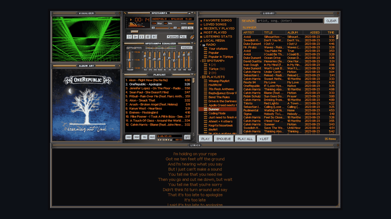
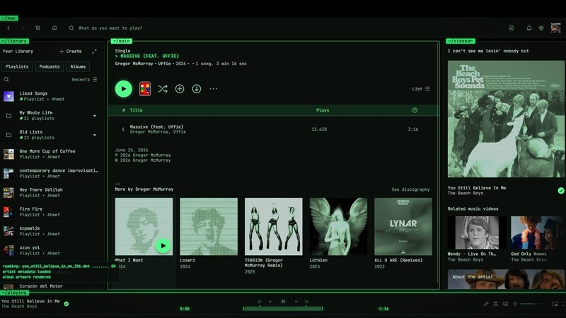
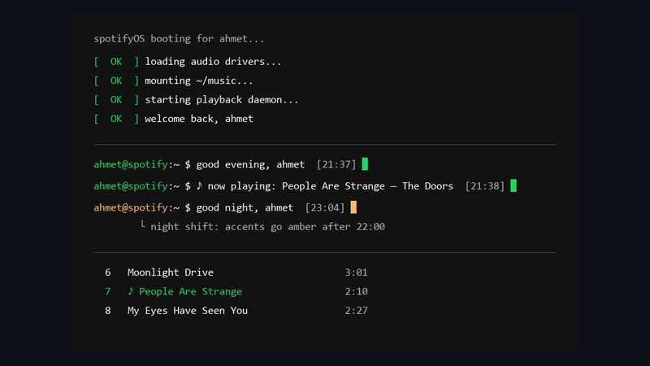
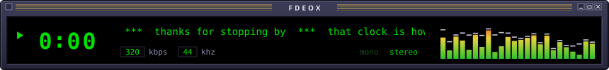

<p align="center">
  <picture>
    <source media="(prefers-color-scheme: light)" srcset="assets/terminal-light.svg">
    
  </picture>
</p>

<p align="center">
  <a href="https://github.com/fdeox?tab=repositories"></a>
  <a href="https://github.com/fdeox?tab=followers"></a>
</p>

## `fdeox@github:~ $ cat about.txt`

- studied **web design & programming** in high school, then **architecture** at university
- working as an **architect**; after hours I build the desktop tools I want to use myself
- everything here is free and open source; most of my other work is private

## `fdeox@github:~ $ ls projects/`

<table>
  <tr>
    <td width="50%" valign="top">
      <a href="https://github.com/fdeox/deonyx"></a>
      <h3><a href="https://github.com/fdeox/deonyx">Deonyx</a></h3>
      <a href="https://github.com/fdeox/deonyx/releases/latest"></a> <a href="https://github.com/fdeox/deonyx/releases"></a> 
      <br><sub>Rust · Tauri · Direct3D</sub>
      <br><br>
      Dark mode for any Windows app. It flips lightness, not colors, so 3D views and pictures stay true and nothing flashes white.
    </td>
    <td width="50%" valign="top">
      <a href="https://github.com/fdeox/spotiamp-plus"></a>
      <h3><a href="https://github.com/fdeox/spotiamp-plus">Spotiamp+</a></h3>
      <a href="https://github.com/fdeox/spotiamp-plus/releases/latest"></a> <a href="https://github.com/fdeox/spotiamp-plus/releases"></a> 
      <br><sub>Rust · Tauri · Svelte</sub>
      <br><br>
      A Winamp-style desktop player for Spotify: real Winamp skins, the equalizer, MilkDrop visuals, your own files and internet radio.
    </td>
  </tr>
  <tr>
    <td width="50%" valign="top">
      <a href="https://github.com/fdeox/termspot"></a>
      <h3><a href="https://github.com/fdeox/termspot">termspot</a></h3>
      <a href="https://github.com/fdeox/termspot/releases/latest"></a> <a href="https://github.com/fdeox/termspot"></a> 
      <br><sub>Spicetify · CSS · JavaScript</sub>
      <br><br>
      Spotify as a CRT phosphor terminal: scanlines, live ASCII album art, a hidden command terminal and 18 color schemes.
    </td>
    <td width="50%" valign="top">
      <a href="https://github.com/fdeox/spicetify-terminal-greeting"></a>
      <h3><a href="https://github.com/fdeox/spicetify-terminal-greeting">Terminal Greeting</a></h3>
      <a href="https://github.com/fdeox/spicetify-terminal-greeting"></a> 
      <br><sub>Spicetify · JavaScript</sub>
      <br><br>
      A terminal prompt on your Spotify home page: a greeting for the time of day, a live clock, a now-playing ticker and a fake boot screen.
    </td>
  </tr>
</table>

<details>
<summary><code>fdeox@github:~ $ ls -a projects/</code></summary>

```text
.  ..  .private/  deonyx/  spotiamp+/  termspot/  terminal-greeting/

fdeox@github:~ $ ls projects/.private/
coming soon...
```

</details>

## `fdeox@github:~ $ ls skills/`

**code**

       

**architecture & design**

      ![Photoshop](https://img.shields.io/badge/Photoshop-001E36?style=flat-square&logo=data%3Aimage%2Fsvg%2Bxml%3Bbase64%2CPHN2ZyB4bWxucz0iaHR0cDovL3d3dy53My5vcmcvMjAwMC9zdmciIHZpZXdCb3g9IjAgMCAyNCAyNCI%2BPHJlY3QgeD0iMS40IiB5PSIxLjQiIHdpZHRoPSIyMS4yIiBoZWlnaHQ9IjIxLjIiIHJ4PSI0LjUiIGZpbGw9Im5vbmUiIHN0cm9rZT0iIzMxQThGRiIgc3Ryb2tlLXdpZHRoPSIxLjgiLz48cGF0aCBmaWxsPSIjMzFBOEZGIiBkPSJNOC4wNzQ3OTA3OTQ5NzkwOCAxMy40NzczMzYxMjI3MzM2MTNWMTYuNzVINS45MzQ5NzIxMDU5OTcyMVY3LjI1SDkuMjg3MTMzODkxMjEzMzlRMTIuODc3Nzg5NDAwMjc4OTM5IDcuMjUgMTIuODc3Nzg5NDAwMjc4OTM5IDEwLjI3NzU0NTMyNzc1NDUzM1ExMi44Nzc3ODk0MDAyNzg5MzkgMTEuNzA4NTA3NjcwODUwNzY4IDExLjg0NzYyOTAwOTc2MjkwMSAxMi41OTI5MjE4OTY3OTIxOTFRMTAuODE3NDY4NjE5MjQ2ODYyIDEzLjQ3NzMzNjEyMjczMzYxMyA5LjA5NTAxMzk0NzAwMTM5NCAxMy40NzczMzYxMjI3MzM2MTNaTTguMDc0NzkwNzk0OTc5MDggOC44OTI5NTY3NjQyOTU2NzVWMTEuODU0MjUzODM1NDI1Mzg0SDguOTE2MTQzNjU0MTE0MzY0UTEwLjYyNTM0ODY3NTAzNDg2OCAxMS44NTQyNTM4MzU0MjUzODQgMTAuNjI1MzQ4Njc1MDM0ODY4IDEwLjM1NzA0MzIzNTcwNDMyNVExMC42MjUzNDg2NzUwMzQ4NjggOC44OTI5NTY3NjQyOTU2NzUgOC45MTYxNDM2NTQxMTQzNjQgOC44OTI5NTY3NjQyOTU2NzVaTTEzLjYxOTc2OTg3NDQ3Njk4NyAxNi41NzExMjk3MDcxMTI5N1YxNC44NzUxNzQzMzc1MTc0MzRRMTQuMTM2NTA2Mjc2MTUwNjI3IDE1LjE4NjU0MTE0MzY1NDExNCAxNC42NDk5MzAyNjQ5OTMwMjQgMTUuMzM4OTEyMTMzODkxMjEzUTE1LjE2MzM1NDI1MzgzNTQyNCAxNS40OTEyODMxMjQxMjgzMTIgMTUuNjIwNDY3MjI0NTQ2NzIgMTUuNDkxMjgzMTI0MTI4MzEyUTE2LjE3Njk1MjU4MDE5NTI1NSAxNS40OTEyODMxMjQxMjgzMTIgMTYuNDk4MjU2NjI0ODI1NjYgMTUuMzM4OTEyMTMzODkxMjEzUTE2LjgxOTU2MDY2OTQ1NjA2NyAxNS4xODY1NDExNDM2NTQxMTQgMTYuODE5NTYwNjY5NDU2MDY3IDE0Ljg3NTE3NDMzNzUxNzQzNFExNi44MTk1NjA2Njk0NTYwNjcgMTQuNjc2NDI5NTY3NjQyOTU3IDE2LjY3MzgxNDUwNDg4MTQ1IDE0LjU0MzkzMzA1NDM5MzMwN1ExNi41MjgwNjgzNDAzMDY4MyAxNC40MTE0MzY1NDExNDM2NTQgMTYuMjk5NTExODU0OTUxMTg0IDE0LjMxMjA2NDE1NjIwNjQxNlExNi4wNzA5NTUzNjk1OTU1MzQgMTQuMjEyNjkxNzcxMjY5MTc4IDE1Ljc5OTMzNzUxNzQzMzc0OSAxNC4xMzMxOTM4NjMzMTkzODhRMTUuNTI3NzE5NjY1MjcxOTY1IDE0LjA1MzY5NTk1NTM2OTU5NiAxNS4yNzU5NzYyOTAwOTc2MjggMTMuOTU0MzIzNTcwNDMyMzU4UTE0Ljg3MTg2MTkyNDY4NjE5MiAxMy44MDE5NTI1ODAxOTUyNTkgMTQuNTYzODA3NTMxMzgwNzUyIDEzLjYyNjM5NDcwMDEzOTQ3MVExNC4yNTU3NTMxMzgwNzUzMTIgMTMuNDUwODM2ODIwMDgzNjgyIDE0LjA0NzA3MTEyOTcwNzExIDEzLjIxODk2NzkyMTg5Njc5MVExMy44MzgzODkxMjEzMzg5MSAxMi45ODcwOTkwMjM3MDk5MDIgMTMuNzI5MDc5NDk3OTA3OTQ4IDEyLjY4MjM1NzA0MzIzNTcwNFExMy42MTk3Njk4NzQ0NzY5ODcgMTIuMzc3NjE1MDYyNzYxNTA3IDEzLjYxOTc2OTg3NDQ3Njk4NyAxMS45NjAyNTEwNDYwMjUxMDVRMTMuNjE5NzY5ODc0NDc2OTg3IDExLjM5MDUxNjAzOTA1MTYwNCAxMy44NjgyMDA4MzY4MjAwODMgMTAuOTc5Nzc2ODQ3OTc3Njg2UTE0LjExNjYzMTc5OTE2MzE3OCAxMC41NjkwMzc2NTY5MDM3NjcgMTQuNTMwNjgzNDAzMDY4MzM4IDEwLjMwNzM1NzA0MzIzNTcwNFExNC45NDQ3MzUwMDY5NzM0OTkgMTAuMDQ1Njc2NDI5NTY3NjQyIDE1LjQ3ODAzMzQ3MjgwMzM0NSA5LjkyMzExNzE1NDgxMTcxNVExNi4wMTEzMzE5Mzg2MzMxOSA5LjgwMDU1Nzg4MDA1NTc4OCAxNi41ODc2OTE3NzEyNjkxNzQgOS44MDA1NTc4ODAwNTU3ODhRMTcuMDM4MTc5OTE2MzE3OTkgOS44MDA1NTc4ODAwNTU3ODggMTcuNTAxOTE3NzEyNjkxNzcgOS44NzAxMTg1NDk1MTE4NTRRMTcuOTY1NjU1NTA5MDY1NTUgOS45Mzk2NzkyMTg5Njc5MjEgMTguNDE2MTQzNjU0MTE0MzY0IDEwLjA3MjE3NTczMjIxNzU3M1YxMS42ODg2MzMxOTM4NjMzMlExOC4wMTg2NTQxMTQzNjU0MSAxMS40NTY3NjQyOTU2NzY0MjkgMTcuNTY0ODUzNTU2NDg1MzUzIDExLjM0MDgyOTg0NjU4Mjk4NFExNy4xMTEwNTI5OTg2MDUzIDExLjIyNDg5NTM5NzQ4OTU0IDE2LjY3MzgxNDUwNDg4MTQ1IDExLjIyNDg5NTM5NzQ4OTU0UTE2LjQ2ODQ0NDkwOTM0NDQ5IDExLjIyNDg5NTM5NzQ4OTU0IDE2LjI4NjI2MjIwMzYyNjIyIDExLjI2MTMzMTkzODYzMzE5NFExNi4xMDQwNzk0OTc5MDc5NDYgMTEuMjk3NzY4NDc5Nzc2ODQ5IDE1Ljk2NDk1ODE1ODk5NTgxMyAxMS4zNjczMjkxNDkyMzI5MTZRMTUuODI1ODM2ODIwMDgzNjggMTEuNDM2ODg5ODE4Njg4OTgyIDE1Ljc0NjMzODkxMjEzMzg5IDExLjU0NjE5OTQ0MjExOTk0NFExNS42NjY4NDEwMDQxODQxIDExLjY1NTUwOTA2NTU1MDkwNSAxNS42NjY4NDEwMDQxODQxIDExLjc5NDYzMDQwNDQ2MzA0UTE1LjY2Njg0MTAwNDE4NDEgMTEuOTgwMTI1NTIzMDEyNTUzIDE1Ljc4NjA4Nzg2NjEwODc4NyAxMi4xMTI2MjIwMzYyNjIyMDRRMTUuOTA1MzM0NzI4MDMzNDcyIDEyLjI0NTExODU0OTUxMTg1NCAxNi4wOTc0NTQ2NzIyNDU0NjUgMTIuMzQxMTc4NTIxNjE3ODUyUTE2LjI4OTU3NDYxNjQ1NzQ2IDEyLjQzNzIzODQ5MzcyMzg1IDE2LjUyNDc1NTkyNzQ3NTU5MiAxMi41MTM0MjM5ODg4NDI0UTE2Ljc1OTkzNzIzODQ5MzcyMyAxMi41ODk2MDk0ODM5NjA5NDkgMTYuOTkxODA2MTM2NjgwNjEyIDEyLjY2OTEwNzM5MTkxMDczOVExNy40MDkxNzAxNTM0MTcwMTYgMTIuODE0ODUzNTU2NDg1MzU3IDE3Ljc0NzAzNjI2MjIwMzYyNiAxMi45ODcwOTkwMjM3MDk5MDJRMTguMDg0OTAyMzcwOTkwMjM1IDEzLjE1OTM0NDQ5MDkzNDQ1IDE4LjMyNjcwODUwNzY3MDg1IDEzLjM5MTIxMzM4OTEyMTM0UTE4LjU2ODUxNDY0NDM1MTQ2MyAxMy42MjMwODIyODczMDgyMjkgMTguNjk3Njk4NzQ0NzY5ODczIDEzLjkzNDQ0OTA5MzQ0NDkxUTE4LjgyNjg4Mjg0NTE4ODI4MyAxNC4yNDU4MTU4OTk1ODE1OSAxOC44MjY4ODI4NDUxODgyODMgMTQuNjc2NDI5NTY3NjQyOTU3UTE4LjgyNjg4Mjg0NTE4ODI4MyAxNS4yNzkyODg3MDI5Mjg4NyAxOC41NjUyMDIyMzE1MjAyMjUgMTUuNzA2NTg5OTU4MTU4OTk1UTE4LjMwMzUyMTYxNzg1MjE2MiAxNi4xMzM4OTEyMTMzODkxMiAxNy44Njk1OTU1MzY5NTk1NSAxNi40MDIxOTY2NTI3MTk2NjdRMTcuNDM1NjY5NDU2MDY2OTQzIDE2LjY3MDUwMjA5MjA1MDIxIDE2Ljg2OTI0Njg2MTkyNDY4NyAxNi43OTMwNjEzNjY4MDYxMzVRMTYuMzAyODI0MjY3NzgyNDI3IDE2LjkxNTYyMDY0MTU2MjA2NCAxNS42OTMzNDAzMDY4MzQwMyAxNi45MTU2MjA2NDE1NjIwNjRRMTQuNTczNzQ0NzY5ODc0NDc1IDE2LjkxNTYyMDY0MTU2MjA2NCAxMy42MTk3Njk4NzQ0NzY5ODcgMTYuNTcxMTI5NzA3MTEyOTdaIi8%2BPC9zdmc%2B) ![InDesign](https://img.shields.io/badge/InDesign-49021F?style=flat-square&logo=data%3Aimage%2Fsvg%2Bxml%3Bbase64%2CPHN2ZyB4bWxucz0iaHR0cDovL3d3dy53My5vcmcvMjAwMC9zdmciIHZpZXdCb3g9IjAgMCAyNCAyNCI%2BPHJlY3QgeD0iMS40IiB5PSIxLjQiIHdpZHRoPSIyMS4yIiBoZWlnaHQ9IjIxLjIiIHJ4PSI0LjUiIGZpbGw9Im5vbmUiIHN0cm9rZT0iI0ZGMzM2NiIgc3Ryb2tlLXdpZHRoPSIxLjgiLz48cGF0aCBmaWxsPSIjRkYzMzY2IiBkPSJNOC44NzYzOTQ3MDAxMzk0NyAxNi43NUg2LjczNjU3NjAxMTE1NzYwMDVWNy4yNUg4Ljg3NjM5NDcwMDEzOTQ3Wk0xNy40Njg3OTM1ODQzNzkzNTUgMTYuNzVIMTUuMzc1MzQ4Njc1MDM0ODY2VjE1LjgxNTg5OTU4MTU4OTk1OEgxNS4zNDg4NDkzNzIzODQ5MzdRMTQuNjMzMzY4MjAwODM2ODE4IDE2LjkxNTYyMDY0MTU2MjA2NCAxMy4yNDg3Nzk2MzczNzc5NjMgMTYuOTE1NjIwNjQxNTYyMDY0UTExLjk3NjgxMzExMDE4MTMxIDE2LjkxNTYyMDY0MTU2MjA2NCAxMS4yMDE3MDg1MDc2NzA4NSAxNi4wMTc5NTY3NjQyOTU2NzVRMTAuNDI2NjAzOTA1MTYwMzkgMTUuMTIwMjkyODg3MDI5Mjg4IDEwLjQyNjYwMzkwNTE2MDM5IDEzLjUxMDQ2MDI1MTA0NjAyNVExMC40MjY2MDM5MDUxNjAzOSAxMS44Mjc3NTQ1MzI3NzU0NTUgMTEuMjgxMjA2NDE1NjIwNjQxIDEwLjgxNDE1NjIwNjQxNTYyMVExMi4xMzU4MDg5MjYwODA4OTEgOS44MDA1NTc4ODAwNTU3ODggMTMuNTIwMzk3NDg5NTM5NzQ3IDkuODAwNTU3ODgwMDU1Nzg4UTE0LjgzMjExMjk3MDcxMTI5NyA5LjgwMDU1Nzg4MDA1NTc4OCAxNS4zNDg4NDkzNzIzODQ5MzcgMTAuNzQxMjgzMTI0MTI4MzEySDE1LjM3NTM0ODY3NTAzNDg2NlY2LjcwNjc2NDI5NTY3NjQyOUgxNy40Njg3OTM1ODQzNzkzNTVaTTE1LjQxNTA5NzYyOTAwOTc2MSAxMy40NTA4MzY4MjAwODM2ODJWMTIuOTQwNzI1MjQ0MDcyNTI0UTE1LjQxNTA5NzYyOTAwOTc2MSAxMi4yNzgyNDI2Nzc4MjQyNjcgMTUuMDMwODU3NzQwNTg1NzczIDExLjg0MTAwNDE4NDEwMDQxOFExNC42NDY2MTc4NTIxNjE3ODQgMTEuNDAzNzY1NjkwMzc2NTcgMTQuMDMwNTA5MDY1NTUwOTA1IDExLjQwMzc2NTY5MDM3NjU3UTEzLjMzNDkwMjM3MDk5MDIzNSAxMS40MDM3NjU2OTAzNzY1NyAxMi45NDQwMzc2NTY5MDM3NjMgMTEuOTUwMzEzODA3NTMxMzgyUTEyLjU1MzE3Mjk0MjgxNzI5MyAxMi40OTY4NjE5MjQ2ODYxOTMgMTIuNTUzMTcyOTQyODE3MjkzIDEzLjQ1MDgzNjgyMDA4MzY4MlExMi41NTMxNzI5NDI4MTcyOTMgMTQuMzQ1MTg4Mjg0NTE4ODI4IDEyLjkzMDc4ODAwNTU3ODggMTQuODI4ODAwNTU3ODgwMDU0UTEzLjMwODQwMzA2ODM0MDMwNiAxNS4zMTI0MTI4MzEyNDEyODIgMTMuOTc3NTEwNDYwMjUxMDQ1IDE1LjMxMjQxMjgzMTI0MTI4MlExNC42MTM0OTM3MjM4NDkzNyAxNS4zMTI0MTI4MzEyNDEyODIgMTUuMDE0Mjk1Njc2NDI5NTY1IDE0LjgwMjMwMTI1NTIzMDEyNVExNS40MTUwOTc2MjkwMDk3NjEgMTQuMjkyMTg5Njc5MjE4OTY4IDE1LjQxNTA5NzYyOTAwOTc2MSAxMy40NTA4MzY4MjAwODM2ODJaIi8%2BPC9zdmc%2B) ![Lightroom](https://img.shields.io/badge/Lightroom-001E36?style=flat-square&logo=data%3Aimage%2Fsvg%2Bxml%3Bbase64%2CPHN2ZyB4bWxucz0iaHR0cDovL3d3dy53My5vcmcvMjAwMC9zdmciIHZpZXdCb3g9IjAgMCAyNCAyNCI%2BPHJlY3QgeD0iMS40IiB5PSIxLjQiIHdpZHRoPSIyMS4yIiBoZWlnaHQ9IjIxLjIiIHJ4PSI0LjUiIGZpbGw9Im5vbmUiIHN0cm9rZT0iIzMxQThGRiIgc3Ryb2tlLXdpZHRoPSIxLjgiLz48cGF0aCBmaWxsPSIjMzFBOEZGIiBkPSJNMTIuNTc2MzU5ODMyNjM1OTgzIDE2Ljc1SDYuOTE4NzU4NzE2ODc1ODcxVjcuMjVIOS4wNTg1Nzc0MDU4NTc3NFYxNS4wMTQyOTU2NzY0Mjk1NjdIMTIuNTc2MzU5ODMyNjM1OTgzWk0xOC4wNzQ5NjUxMzI0OTY1MTIgMTEuODU0MjUzODM1NDI1Mzg0UTE3LjY5NzM1MDA2OTczNTAwNSAxMS42NDg4ODQyMzk4ODg0MjQgMTcuMTkzODYzMzE5Mzg2MzMgMTEuNjQ4ODg0MjM5ODg4NDI0UTE2LjUxMTUwNjI3NjE1MDYyNyAxMS42NDg4ODQyMzk4ODg0MjQgMTYuMTI3MjY2Mzg3NzI2NjQgMTIuMTQ5MDU4NTc3NDA1ODU4UTE1Ljc0MzAyNjQ5OTMwMjY1IDEyLjY0OTIzMjkxNDkyMzI5MiAxNS43NDMwMjY0OTkzMDI2NSAxMy41MTA0NjAyNTEwNDYwMjVWMTYuNzVIMTMuNjQ5NTgxNTg5OTU4MTU4VjkuOTY2MTc4NTIxNjE3ODUySDE1Ljc0MzAyNjQ5OTMwMjY1VjExLjIyNDg5NTM5NzQ4OTU0SDE1Ljc2OTUyNTgwMTk1MjU3OVExNi4yNjYzODc3MjY2Mzg3NzIgOS44NDY5MzE2NTk2OTMxNjYgMTcuNTU4MjI4NzMwODIyODcyIDkuODQ2OTMxNjU5NjkzMTY2UTE3Ljg4OTQ3MDAxMzk0NyA5Ljg0NjkzMTY1OTY5MzE2NiAxOC4wNzQ5NjUxMzI0OTY1MTIgOS45MjY0Mjk1Njc2NDI5NTdaIi8%2BPC9zdmc%2B)

...and most of the usual suspects. **tools:** whatever gets the job done.

## `fdeox@github:~ $ cat contact.txt`

- questions or ideas about a project? come say hi on Discord: [Spotiamp+](https://discord.gg/8Rq5Xycny4) · [Deonyx](https://discord.gg/5Z6XRtKG2V)
- found a bug? open an issue in the project's repo, I read them all

<br>

<p align="center">
  
</p>
